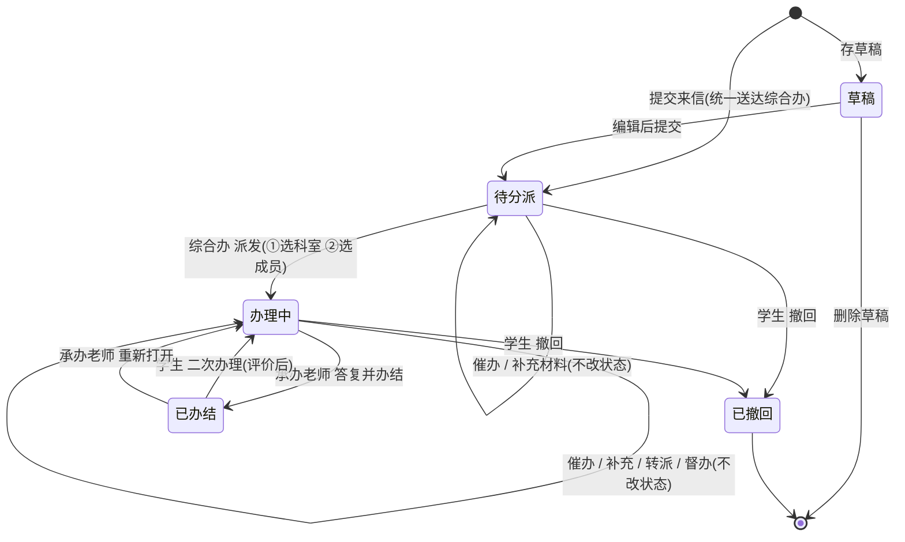
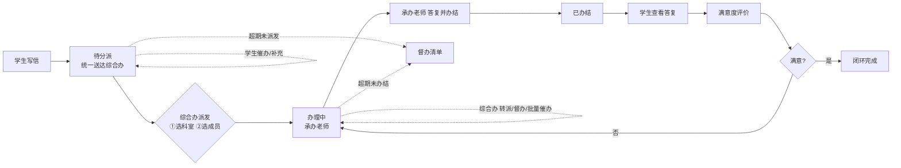
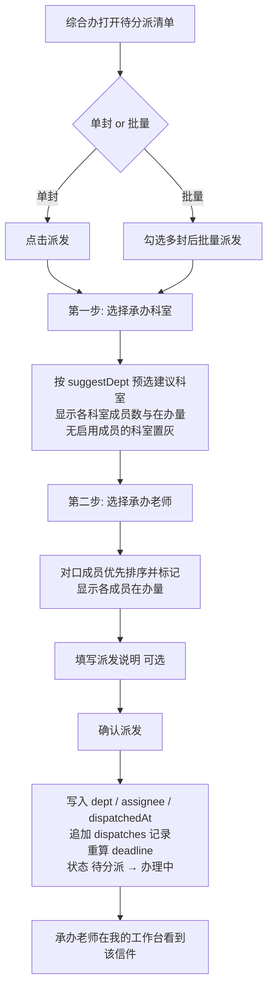

# 学工信箱系统 产品需求文档（PRD）

## 1. 文档信息 / 修订记录

| 项目 | 内容 |
| --- | --- |
| 文档名称 | 学工信箱系统 产品需求文档（PRD） |
| 产品名称 | 学工信箱（Student Affairs Mailbox） |
| 版本 | v2.0 |
| 日期 | 2026-09 |
| 作者 | 产品负责人（占位） |
| 状态 | **原型阶段**（高保真交互原型，纯前端实现） |
| 适用端 | PC 桌面端 + 移动端 H5 |

### 修订记录

| 版本 | 日期 | 修订人 | 说明 |
| --- | --- | --- | --- |
| v1.0 | 2026-07 | 产品负责人（占位） | 首版，依据现有原型实现整理 |
| v2.0 | 2026-09 | 产品负责人（占位） | **业务流程调整**：由「按事务自动归口科室」改为「综合办统一受理 → 人工派发到科室具体成员承办」。新增「待分派」状态、两步派发（先选科室再选成员）、批量派发与转派、科室成员配置；角色「科室负责人」调整为「科室教师」，「管理员」明确为「综合办管理员」。同步改写状态机、数据字典、功能清单与权限矩阵 |

> 说明：本 PRD **严格对齐当前原型代码实现**（`js/data.js`、`js/app.js`、`js/mobile.js`、`tools/build-pages.js`）。凡未实现、仅为演示占位或建议后续对接的内容，均归入第 12 章「原型局限与待对接」，不与「已实现」混淆。

---

## 2. 项目背景与目标

高校学生工作部（简称「学工部」）日常承接大量学生诉求（建议、问题、咨询、感谢、投诉），传统线下 / 分散渠道存在**受理入口不统一、责任人不明确、进度不透明、缺乏数据沉淀**等问题。「学工信箱」面向学生提供统一的在线诉求提交与跟踪入口，采用**「综合办统一受理 → 派发到科室具体承办人」**的两级流转模式：全部来信先集中送达学工部综合办公室，由综合办管理员统筹研判后派发到对应科室的**具体承办老师**，形成「提交—受理—派发—办理—答复—评价」的闭环。

> **v2.0 流程变更说明**：v1.0 采用「按事务分类自动归口科室」的单级流转，来信提交后直接进入「办理中」并由科室负责人办理。v2.0 在中间增加了**人工受理与派发**环节，责任主体从「科室」下沉到「科室内的具体人」，原有的事务→科室映射保留为派发时的**建议值**而非强制归口。

**产品目标：**

1. **畅通诉求渠道**：为学生提供 PC + 移动统一入口，降低表达门槛。
2. **统一受理**：全部来信集中到综合办公室登记受理，避免多头入口与责任真空。
3. **精准派发**：先选科室、再选成员，责任落实到具体承办老师；系统按事务给出建议科室与对口成员，并展示各成员在办量辅助均衡分配。
4. **闭环跟踪**：全流程状态可视（受理、派发记录、时间线、答复、催办、补充、评价、二次办理）。
5. **督办提效**：超期自动标记（含「超期未派发」，压实综合办派发时效）、学生催办与管理员批量催办、模板化通知。
6. **数据分析**：多维度统计（时间趋势、分类、科室绩效、**承办人绩效**、满意度、超期、催办）辅助管理决策。

---

## 3. 范围与角色

### 3.1 In-Scope（本期原型范围）

- 学生来信端：写信提交、我的信件（含「待分派」状态跟踪）、草稿、撤回、补充材料、催办、满意度评价、二次办理、公开信件浏览、制度文件查看、数据统计、科室联系方式（含承办老师）、常见问题。
- 综合办管理员端：**待分派清单、两步派发（先选科室再选成员）、批量派发、转派**、全量收件箱、督办催办（含批量催办）、来信选登、统计分析（ECharts），以及分类 / **科室与科室成员** / 制度文件 / 常见问题 / 超期与催办 的配置维护。
- 科室教师端：我的工作台（本人承办口径）、科室收件箱（「我承办的 / 本科室全部」范围切换）、答复并办结、重新打开（**仅限派发给本人的信件**）。
- 角色与承办人身份切换（演示用）、附件上传与预览、PC + 移动双端。

### 3.2 Out-of-Scope（本期不含）

- 真实用户注册 / 统一身份认证（SSO）与权限鉴权后端。
- 真实消息通知通道（短信 / 邮件 / 校内系统对接）与站内「消息中心」页面。
- 附件真实存储与下载、在线预览服务。
- 服务端数据库与多用户并发（当前为浏览器 `localStorage` 单机模拟）。
- 工作流引擎、审批链、跨部门协同等高级流程。
- 自动派发 / 智能分案（当前派发为人工操作，系统仅提供建议科室与对口成员提示）。
- 承办人请假代办、批量转派、派发时限单独考核等精细化派发治理能力。

### 3.3 角色说明

| 角色 | 定位 | 可见范围 | 核心职责 |
| --- | --- | --- | --- |
| **学生**（student） | 诉求提交方 | 本人信件 + 公开信息 | 写信、查看我的信件与公开信件、撤回、催办、补充、评价、二次办理 |
| **科室教师**（section） | 承办方（科室成员） | 本科室**已派发**信件全部可见；**未派发信件不可见** | 办理并答复**派发给本人**的信件、重新打开；可查看同科室其他成员的承办情况（只读） |
| **综合办管理员**（admin） | 统一受理与派发方 | **全部**信件（含未派发） | 受理登记、派发 / 批量派发 / 转派、督办催办、内容管理与全部配置（含科室成员）、统计分析 |

**权限边界（v2.0 关键约束）：**

1. 科室教师可**查看**本科室全部承办信件（便于同事协同与交接），但**仅能答复派发给本人的信件**；非本人承办的信件在办理弹窗中不展示答复输入框，仅提示当前承办人。
2. 「待分派」信件对所有科室**均不可见**，仅综合办管理员可见可操作。
3. 科室教师**无派发 / 转派权限**；需更换承办人时由综合办执行转派。

> 支持端：学生端覆盖 PC + 移动；综合办与科室办理端 PC 功能完整，移动端提供核心受理派发、办理与统计（批量派发、批量催办、后台配置等重操作为 PC 专属）。

---

## 4. 功能清单表（必备）

优先级：**P0** = 核心闭环必备；**P1** = 重要增强；**P2** = 辅助 / 运营。

| 编号 | 模块 | 功能名称 | 角色 | 功能描述 | 优先级 | 端 | 备注 |
| --- | --- | --- | --- | --- | --- | --- | --- |
| F-01 | 写信 | 写信提交 | 学生 | 填写标题 / 分类 / 事务分类 / 正文（纯文本，≤2000 字）/ 附件 / 是否公开并提交 | P0 | 两者 | 正文为 `<textarea>`，字数计数 |
| F-02 | 写信 | 统一受理入池 | 系统 | 提交后信件统一送达综合办公室，置状态「待分派」，`dept` 留空，同时按 `affairToSection[事务分类]` 计算并写入**建议归口科室** `suggestDept` | P0 | 两者 | 替代 v1.0 的「自动归口路由」 |
| F-03 | 写信 | AI 润色 | 学生 | 一键将正文润色为规范表达（纯文本，前端本地模拟），可对照后应用 | P1 | 两者 | 不改变字段结构 |
| F-04 | 写信 | 写信须知 | 学生 | 展示受理 / 不予受理范围 + **五段式办理流程图示** + 倒计时阅读 | P2 | 两者 | 流程取 `FLOW_STEPS` |
| F-05 | 写信 | 重复来信校验 | 学生 | 同标题且非草稿的已提交信件拦截 | P1 | 两者 | 前端提示 |
| F-06 | 草稿 | 存草稿 / 编辑 / 删除 | 学生 | 保存为草稿、继续编辑、删除草稿 | P1 | 两者 | 单草稿模型（见 5、12） |
| F-07 | 我的信件 | 列表 + 状态筛选 | 学生 | 全部 / **待分派** / 办理中 / 已办结 / 草稿 分页，展示「承办科室 / 承办人」列、正文摘要、超期 / 催办 / 补充标签 | P0 | 两者 | 未派发显示「待综合办派发」+ 建议归口 |
| F-08 | 我的信件 | 信件详情 | 学生 | 标签信息（含承办科室 / 承办人）+ 内容 + 补充材料 + **派发记录** + 催办记录 + 五段式办理时间线 + 答复（含承办人署名）+ 评价区 | P0 | 两者 | — |
| F-09 | 办理跟踪 | 撤回信件 | 学生 | 「**待分派**」或「办理中」信件可撤回为「已撤回」 | P1 | 两者 | 仅本人、非已办结 |
| F-10 | 办理跟踪 | 补充材料 | 学生 | 对未办结信件追加说明文字 + 附件，进入时间线与办理端 | P1 | 两者 | 文字或附件至少其一 |
| F-11 | 办理跟踪 | 催办 | 学生 | 按模板生成催办内容、选择渠道（系统消息 / ITS）发送并记录；**已派发送承办科室与承办人，未派发送综合办公室** | P1 | 两者 | 记录入 `reminders[]` |
| F-12 | 评价 | 满意度评价 | 学生 | 已办结后评分（1–5 星，必填）+ 快捷标签（多选）+ 文字（选填） | P0 | 两者 | 评价后转只读 |
| F-13 | 评价 | 二次办理 | 学生 | 已评价后对结果不满意，重新进入「办理中」并清空答复 / 评价，**保留原承办人继续办理** | P1 | 两者 | 如需换人由综合办转派 |
| F-15 | 信息公开 | 公开信件浏览 | 学生/科室 | 浏览已办结且公开的信件与答复 | P1 | 两者 | `isPublic="yes"` |
| F-16 | 信息公开 | 制度文件查看 | 学生/科室 | 浏览制度文件正文（富文本）+ 附件 | P1 | 两者 | — |
| F-17 | 信息公开 | 数据统计（前台） | 学生 | 展示累计来信 / 待分派 / 办理中 / 办结 / 满意度等概览 | P2 | 两者 | 数据实时派生 |
| F-18 | 帮助 | 常见问题（前台） | 学生 | 展示管理员配置的 FAQ（仅启用、按排序） | P2 | 两者 | 读 `xg_faq_v2` |
| F-19 | 帮助 | 科室联系方式 | 学生 | 展示各科室负责人 / 电话 / 邮箱 / 职责，并列出**该科室承办老师**（姓名 / 岗位 / 电话） | P2 | 两者 | 仅展示启用成员 |
| **F-20** | **受理派发** | **待分派清单** | 综合办 | 独立页面展示全部「待分派」信件，含待分派总数 / 超期数 / 可选承办老师数统计、标题与事务筛选、建议归口列、最近派发记录 | **P0** | 两者 | 路由 `dispatch` |
| **F-21** | **受理派发** | **两步派发** | 综合办 | 弹窗内**第一步选承办科室**（预选建议科室，显示各科室成员数与在办量）→ **第二步选承办老师**（对口成员优先并标记「对口」，显示各成员在办量）→ 填写派发说明 → 确认；写入 `dept`/`assignee`/`dispatches[]`，状态转「办理中」 | **P0** | 两者 | 核心新增功能 |
| **F-22** | **受理派发** | **批量派发** | 综合办 | 在待分派清单勾选多封（支持全选），统一派发至同一科室与承办老师 | P1 | PC | 复选 + 全选 |
| **F-23** | **受理派发** | **转派承办** | 综合办 | 对已派发（办理中）信件重新指定科室与承办人，复用两步选择器；追加 `type="转派"` 的派发记录并保留原承办方信息 | P1 | 两者 | 替代 v1.0「转办科室」 |
| F-24 | 科室办理 | 我的工作台 | 科室教师 | 以**本人承办**为口径的统计（我承办的 / 待我办理 / 我已办结 / 超期）+ 待我办理清单 + 本科室成员承办分布表 | P0 | 两者 | — |
| F-25 | 科室办理 | 科室收件箱 | 科室教师 | 「**我承办的 / 本科室全部**」范围切换 + 状态页签 + 筛选；列表含承办人列并标记「本人」 | P0 | 两者 | 越权访问拦截 |
| F-26 | 科室办理 | 答复并办结 | 科室教师 | 填写答复内容，置「已办结」并写入 `reply`（含承办人署名 `by`） | P0 | 两者 | **仅本人承办件**可答复；答复不可为空 |
| F-27 | 科室办理 | 重新打开 | 科室教师 | 将本人承办的已办结信件重置为「办理中」 | P1 | 两者 | 仅本人承办件 |
| F-28 | 管理办理 | 办理工作台 | 综合办 | 待分派 / 办理中 / 已办结 / 超期概览 + **待分派来信**快捷派发入口 + 三态占比图 | P0 | 两者 | — |
| F-29 | 管理办理 | 信件收件箱（全量） | 综合办 | 全部信件列表，页签含「待分派」，列含「承办科室 / 承办人」，支持按承办人检索；待分派行直接提供派发按钮 | P0 | 两者 | — |
| F-30 | 督办 | 督办催办工作台 | 综合办 | 超期未办结清单 + **超期未派发**指标 + 学生催办件 + 临期待办 | P1 | 两者 | 待分派件提供「去派发」 |
| F-31 | 督办 | 督办提醒（单件） | 综合办 | 对单件按模板发送催办并记录 | P1 | 两者 | `by="admin"` |
| F-32 | 督办 | 批量催办 | 综合办 | 勾选多封（未办结）批量按模板催办，汇总提示 | P1 | PC | 复选 + 全选 |
| F-33 | 运营 | 来信选登管理 | 综合办 | 将已办结信件选登公开 / 取消公开 | P1 | PC | 切换 `isPublic` |
| F-34 | 运营 | 统计分析（ECharts） | 综合办 | 年 / 季 / 月趋势 + 分类 + 承办科室 + 状态（含待分派）+ 满意度 + 超期 + 催办 + **承办人绩效**，多维筛选 | P1 | PC（移动为轻量趋势） | ECharts 实时派生 |
| F-35 | 配置 | 分类管理 | 综合办 | 信件分类 / 事务分类增删改 + 事务→**建议归口科室**绑定 | P1 | PC | 绑定仅作派发预选 |
| F-36 | 配置 | 科室管理 | 综合办 | 科室及负责人 / 联系方式 / 职责 / 承接事务维护；点击科室行联动切换下方成员列表 | P1 | PC | 统一受理科室不可删除 |
| **F-37** | **配置** | **科室成员管理** | 综合办 | 对所选科室的成员（承办老师）增删改与**启用 / 停用**：姓名、岗位职务、电话、邮箱、负责事务（多选）、状态；成员即派发时可选的承办人 | **P0** | PC | 核心新增功能 |
| F-38 | 配置 | 制度文件管理 | 综合办 | 制度文件富文本正文 + 附件的增删改 + 预览 | P1 | PC | 富文本编辑器 |
| F-39 | 配置 | 超期与催办配置 | 综合办 | 超期天数 + 催办模板（新增 `{承办人}` 占位符）+ 默认渠道，保存实时生效 | P1 | PC | 写 `xg_config_v8` |
| F-40 | 配置 | 常见问题配置 | 综合办 | FAQ 增删改 / 启用停用 / 上移下移排序 | P1 | PC | 写 `xg_faq_v2` |
| F-41 | 通用 | 角色 / 承办人切换 | 全部 | 顶栏 / 更多页切换学生 / 科室教师 / 综合办管理员视角；科室教师提供**两级选择器（科室 → 本人）** | P1 | 两者 | 演示用，真实系统由登录态确定 |
| F-42 | 通用 | 附件上传 / 预览 | 全部 | 点击 / 拖拽上传，缩略图、大小、删除、点击预览（下载为占位） | P1 | 两者 | `{name,size,type}` |

---

## 5. 状态流转（必备，含异常分支）

### 5.1 信件状态集合（实际取值）

`草稿`（draft）｜`待分派`（pending）｜`办理中`（processing）｜`已办结`（done）｜`已撤回`（withdrawn）

> **v2.0 变更**：新增 `待分派`。代码中以 `STATUS` 常量枚举统一维护（`js/data.js`），避免状态字符串散落。
>
> 「待分派」表示信件已送达综合办公室并完成登记受理，但**尚未确定承办科室与承办人**——此时 `dept` 为空字符串、`assignee` 为 `null`。该状态同样计入超期判定，超期后进入督办清单的「超期未派发」口径。
>
> v1.0 中办理流程模板里的展示用阶段名「待受理」已废弃，v2.0 的时间线阶段与真实状态对应关系见 5.4。

### 5.2 状态机图（mermaid）

### 5.3 状态流转表（含前置条件与异常 / 边界分支）

| 当前状态 | 触发事件 / 操作 | 触发角色 | 目标状态 | 前置条件 | 异常 / 边界分支 |
| --- | --- | --- | --- | --- | --- |
| （无） | 存草稿 | 学生 | 草稿 | 已登录学生视角 | 单草稿模型：同一用户仅保留一封草稿，再存草稿会合并到既有草稿 |
| （无）/ 草稿 | 提交来信 | 学生 | **待分派** | 姓名 / 标题 / 分类 / 事务分类 / 正文均必填 | ①正文 <10 字被拦截；②`maxlength=2000` 限制超字数；③同标题重复来信拦截；④`dept` 置空串、`assignee` 置 null，同时写入建议归口 `suggestDept`（缺省「综合办公室」） |
| 草稿 | 删除草稿 | 学生 | （删除） | 本人草稿 | 仅本人可见 / 可删 |
| **待分派** | **派发** | **综合办** | **办理中** | 综合办角色 + 已选科室 + 已选该科室成员 | ①未选科室或未选成员被拦截；②无启用成员的科室在选择器中置灰不可选；③写入 `dept`/`assignee`/`dispatchedAt`，追加 `dispatches[]` 记录（`type="派发"`）并重算 `deadline`；④科室教师无派发权限 |
| **待分派** | **批量派发** | **综合办** | **办理中**（批量） | 至少勾选 1 封 | ①PC 专属；②所选信件统一派给同一科室与同一承办人；③每封各自写入一条派发记录 |
| **待分派** | 撤回信件 | 学生 | 已撤回 | 本人 + 状态=待分派 | 未派发即撤回时不产生派发记录 |
| **待分派** | 催办 / 补充材料 | 学生 | 待分派（不变） | 本人 | 催办对象为**综合办公室**（`{科室}` 回退为综合办、`{承办人}` 为空） |
| **待分派** | 超期判定 | 系统（派生） | 状态不变，标记「超期」 | `当前日期 > createdAt + overdueDays` | 计入督办页「**超期未派发**」指标，行内提供「去派发」入口 |
| 办理中 | 撤回信件 | 学生 | 已撤回 | 本人 + 状态=办理中 | ①「已办结」不提供撤回入口；②非本人无法撤回；③撤回后仍可在「我的信件·全部」中查看 |
| 办理中 | 催办 | 学生 | 办理中（不变） | 本人 + 未办结 | ①至少选择一种渠道，否则拦截；②已催办后列表 / 详情显示「已催办」，行内按钮置灰（`urged=true`）；③催办送达**承办科室 + 承办人**；④生成 `reminder` 记录并置 `urgedAt` |
| 办理中 | 补充材料 | 学生 | 办理中（不变） | 本人 + 未办结 | ①文字与附件不可同时为空，否则拦截；②追加到 `supplements[]` 并插入时间线；③综合办与承办老师均可见 |
| 办理中 | **转派承办** | **综合办** | 办理中（不变） | 综合办 + 状态≠已办结 | ①复用两步选择器，可跨科室改派；②追加 `type="转派"` 的派发记录并保留 `fromSection`/`fromName`；③同步改写 `dept`/`assignee` 并重算 `deadline`；④科室教师无转派权限 |
| 办理中 | 督办提醒 / 批量催办 | 综合办 | 办理中（不变） | 综合办；批量仅作用于状态≠已办结 | ①批量催办为 PC 专属；②生成 `reminder`（`by=admin`）并汇总提示「已批量催办 N 封」 |
| 办理中 | 答复并办结 | **科室教师** | 已办结 | **信件的 `assignee.memberId` = 当前登录成员** + 答复内容非空 | ①答复为空被拦截；②非本人承办件不展示答复输入框（仅提示当前承办人）；③非本科室信件越权 `toast` 拦截；④待分派信件对科室不可见，打开时提示「尚未派发」；⑤写入 `reply={dept,by,time,content}`，`by` 为承办人署名 |
| 已办结 | 满意度评价 | 学生 | 已办结（不变） | 本人 + 状态=已办结 + 未评价 | ①星级必填（未选拦截）；②标签多选、文字选填；③提交后转只读，写入 `rating/ratingTags/ratingComment/ratedAt` |
| 已办结 | 二次办理 | 学生 | 办理中 | 本人 + **已评价**（`rating` 存在） | ①未评价时不展示二次办理入口；②清空 `reply/rating/ratingTags/ratingComment/ratedAt`，重算 `deadline`，置 `reopened=true`；③**保留 `dept` 与 `assignee`**，由原承办老师重新办理，如需换人由综合办转派 |
| 已办结 | 重新打开 | 科室教师 | 办理中 | 本人承办件 | 用于办理端修正，不清空评价字段 |
| 待分派 / 办理中 | 超期判定 | 系统（派生） | 状态不变，标记「超期」 | `当前日期 > createdAt + overdueDays` | ①`已办结 / 已撤回` 永不超期；②`overdueDays` 改小（如 0）即时让更多信件超期；③超期仅打标 + 进督办清单，无自动升级动作（见 12） |

### 5.4 办理流程时间线（展示阶段与状态的对应）

时间线由 `buildProcessLog()` 依据信件当前状态与派发记录动态生成，共五段：

| 序 | 阶段名 | 责任方 | 出现条件 |
| --- | --- | --- | --- |
| 1 | 提交来信 | 来信人 | 恒常出现 |
| 2 | 综合办公室受理 | 综合办公室 | 恒常出现（「待分派」时文案为「正在确定承办科室与承办人」） |
| 3 | 派发承办 / 转派承办 | 综合办公室 | 存在派发记录时按记录逐条展开；无记录但已有 `dept` 时按当前承办信息推导一条 |
| 4 | 科室办理 | 承办科室 | `dept` 非空且状态≠待分派 |
| 5 | 答复反馈 | 承办科室 | 状态=已办结 |

补充材料节点按提交顺序插入在第 1 段之后；「已撤回」信件时间线在第 1 段后直接终止于「来信人撤回」。

> **时间单调性**：第 3、5 段取真实操作时间（派发时间、答复时间），第 1、2、4 段按 `createdAt` 偏移推导。两者混排可能出现时间倒退，故实现上采用**单调时钟**——每个节点取「推导时间」与「上一节点 + 1 小时」的较大值，保证时间轴严格递增。

---

## 6. 数据字典（必备）

> 数据均以浏览器 `localStorage` 持久化（键见 6.13）；运行期以 `MOCK` 对象承载种子数据。

### 6.1 信件 Letter（`xg_letters` 数组元素）

| 字段名 | 类型 | 必填 | 说明 / 取值范围 | 示例 |
| --- | --- | --- | --- | --- |
| id | string | 是 | 信件编号（即「编号」），`XG+YYYYMMDD+3位` | `XG20260612118` |
| mailbox | string | 是 | 所属信箱，固定「学工信箱」 | `学工信箱` |
| owner | string | 是 | 归属：`me`=本人 / `other`=其他同学 | `me` |
| title | string | 是 | 来信标题（≤80 字） | `关于…的建议` |
| category | string | 是 | 一级信件分类（见 6.12） | `建议类` |
| affair | string | 是 | 二级事务分类（见 6.12），用于计算建议归口与「对口」成员推荐 | `奖助学金` |
| dept | string | 是 | **承办科室**。v2.0 语义变更：**「待分派」期间为空字符串 `""`**，派发后才写入；展示层统一经 `deptLabel()` 回退为「待分派」 | `学生资助管理科` |
| suggestDept | string | 否 | **【v2.0 新增】** 建议归口科室，提交时由 `affairToSection[affair]` 计算写入，仅用于派发弹窗预选，不约束实际派发结果 | `学生资助管理科` |
| assignee | Assignee\|null | 否 | **【v2.0 新增】** 承办人快照（见 6.11），未派发为 `null` | `{…}` |
| dispatches | Dispatch[] | 否 | **【v2.0 新增】** 派发 / 转派流水（见 6.7），未派发为空数组 | `[{…}]` |
| dispatchedAt | string | 否 | **【v2.0 新增】** 最近一次派发时间（YYYY-MM-DD HH:mm） | `2026-09-07 16:14` |
| name | string | 是 | 来信人姓名 | `李诚` |
| idInfo | string | 否 | 证件 / 学号信息（他人来信显示「保密」） | `8201230314` |
| phone | string | 否 | 联系电话 | `13874105021` |
| email | string | 否 | 联系邮箱 | `licheng@example.edu.cn` |
| unit | string | 否 | 所在单位 / 学院 | `计算机学院` |
| address | string | 否 | 联系地址 | `杏林校区A栋` |
| content | string | 是 | 正文（纯文本，≤2000；≥10 字方可提交） | `建议…` |
| attachments | Attachment[] | 否 | 附件数组（见 6.2） | `[{…}]` |
| isPublic | string | 是 | 是否可公开：`yes` / `no` | `yes` |
| status | string | 是 | 状态：`草稿`/**`待分派`**/`办理中`/`已办结`/`已撤回` | `待分派` |
| createdAt | string(ISO) | 是 | 来信时间（含时分），超期判定基准 | `2026-06-12T09:10:00` |
| date | string | 是 | 来信日期（YYYY-MM-DD） | `2026-06-12` |
| deadline | string | 否 | 办结时限（存储值；展示以 `effectiveDeadline` 实时计算为准） | `2026-06-19` |
| urged | boolean | 否 | 是否已催办 | `true` |
| urgedAt | string | 否 | 最近一次催办时间 | `2026-07-20 17:17` |
| reopened | boolean | 否 | 是否经历过二次办理 / 重新打开 | `false` |
| reply | Reply\|null | 否 | 办理答复对象（见 6.3），未答复为 `null` | `{…}` |
| rating | number\|null | 否 | 满意度星级 1–5，未评价为 `null` | `5` |
| ratingTags | string[] | 否 | 评价快捷标签（见 6.12） | `["办理及时"]` |
| ratingComment | string | 否 | 评价文字 | `答复很快…` |
| ratedAt | string | 否 | 评价日期 | `2026-06-15` |
| supplements | Supplement[] | 否 | 补充材料数组（见 6.5） | `[{…}]` |
| reminders | Reminder[] | 否 | 催办记录数组（见 6.6） | `[{…}]` |
| level | string | 否 | **【遗留字段】** 旧「一般/重要/疑难/复杂」分级；新信件不再写入，**已不参与超期计算**（改用统一 `overdueDays`），仅历史种子数据保留 | `重要` |

### 6.2 附件 Attachment

| 字段名 | 类型 | 必填 | 说明 / 取值范围 | 示例 |
| --- | --- | --- | --- | --- |
| name | string | 是 | 文件名（含扩展名） | `调整申请表.jpg` |
| size | number | 是 | 文件字节数 | `251904` |
| type | string | 否 | MIME 类型 | `image/jpeg` |
| url | string | 否 | 运行期图片预览的 objectURL（不持久化） | `blob:…` |

### 6.3 答复 Reply

| 字段名 | 类型 | 必填 | 说明 | 示例 |
| --- | --- | --- | --- | --- |
| dept | string | 是 | 承办科室 | `学生资助管理科` |
| by | string | 否 | **【v2.0 新增】** 承办人署名（`姓名（岗位）`），学生端答复落款展示 | `邱敏（资助干事）` |
| time | string | 是 | 答复时间（YYYY-MM-DD HH:mm） | `2026-06-14 16:20` |
| content | string | 是 | 答复正文（纯文本） | `感谢您的建议…` |

### 6.4 评价 Rating（内联于 Letter，非独立对象）

| 字段名 | 类型 | 必填 | 说明 | 示例 |
| --- | --- | --- | --- | --- |
| rating | number | 是 | 星级 1–5 | `4` |
| ratingTags | string[] | 否 | 快捷标签（多选） | `["流程清晰","结果满意"]` |
| ratingComment | string | 否 | 文字评价（≤300） | `整体不错` |
| ratedAt | string | 否 | 评价日期 | `2026-07-20` |

### 6.5 补充材料 Supplement（`letter.supplements[]`）

| 字段名 | 类型 | 必填 | 说明 | 示例 |
| --- | --- | --- | --- | --- |
| id | string | 是 | 补充记录 id（`SUP+…`） | `SUPlx3k12` |
| at | string | 是 | 提交时间（YYYY-MM-DD HH:mm） | `2026-07-20 16:52` |
| by | string | 是 | 提交方，固定 `student` | `student` |
| text | string | 否 | 补充说明文字 | `已附上材料…` |
| attachments | Attachment[] | 否 | 补充附件（见 6.2） | `[{…}]` |

### 6.6 催办记录 Reminder（`letter.reminders[]`）

| 字段名 | 类型 | 必填 | 说明 | 示例 |
| --- | --- | --- | --- | --- |
| id | string | 是 | 催办 id（`RM+…`） | `RMlx3k77` |
| at | string | 是 | 催办时间 | `2026-07-20 17:17` |
| by | string | 是 | 发起方：`student` / `admin` | `student` |
| channel | string[] | 是 | 发送渠道：`sys` / `its`（见 6.12） | `["sys","its"]` |
| text | string | 是 | 按模板填充后的催办正文 | `尊敬的…请尽快处理` |
| sectionId | string | 是 | 目标科室名；**未派发时回退为「综合办公室」** | `学生公寓管理科` |
| memberId | string | 否 | **【v2.0 新增】** 目标承办人 id，未派发时为空串 | `M602` |

### 6.7 派发记录 Dispatch（`letter.dispatches[]`）【v2.0 新增】

> 每执行一次派发或转派追加一条，用于详情页「派发记录」区块与办理流程时间线的第 3 段。

| 字段名 | 类型 | 必填 | 说明 | 示例 |
| --- | --- | --- | --- | --- |
| id | string | 是 | 派发记录 id（`DP+…`） | `DPmtqysnyi972` |
| at | string | 是 | 派发时间（YYYY-MM-DD HH:mm） | `2026-09-07 16:14` |
| by | string | 是 | 操作方，固定 `admin`（综合办管理员） | `admin` |
| type | string | 是 | 类型：`派发`（首次）/ `转派`（改派） | `派发` |
| section | string | 是 | 目标承办科室 | `学生公寓管理科` |
| memberId | string | 是 | 目标承办人 id | `M602` |
| name | string | 是 | 目标承办人姓名（快照） | `蒋磊` |
| title | string | 否 | 目标承办人岗位（快照） | `公寓管理员` |
| fromSection | string | 否 | 原承办科室；首次派发为空串 | `学生日常管理科` |
| fromName | string | 否 | 原承办人姓名；首次派发为空串 | `何静` |
| note | string | 否 | 派发说明，展示在时间线与派发记录中 | `请三个工作日内联系学生并答复` |

### 6.8 通知 Notification（`MOCK.notifications[]`）

> **现状：仅写入不展示**——`sendUrge` 会向该数组追加记录，但暂无「消息中心」页面读取（见 12）。为运行期内存，不持久化。

| 字段名 | 类型 | 必填 | 说明 | 示例 |
| --- | --- | --- | --- | --- |
| letterId | string | 是 | 关联信件编号 | `XG20260701203` |
| id / at / by / channel / text / sectionId | 同 Reminder | 是 | 同催办记录结构 | 见 6.6 |

### 6.9 常见问题 FAQ（`xg_faq_v2` 数组元素）

| 字段名 | 类型 | 必填 | 说明 | 示例 |
| --- | --- | --- | --- | --- |
| id | string | 是 | FAQ id | `faq1` |
| q | string | 是 | 问题（≤60） | `写信后多久能收到回复？` |
| a | string | 是 | 解答 | `来信统一送达综合办公室，由其派发…` |
| category | string | 否 | 分类（自由文本） | `办理流程` |
| order | number | 是 | 排序（保存时按数组顺序归一） | `1` |
| enabled | boolean | 是 | 是否启用（学生端仅展示 `true`） | `true` |

### 6.10 制度文件 Policy（`MOCK.policies[]`，随 config 持久化）

| 字段名 | 类型 | 必填 | 说明 | 示例 |
| --- | --- | --- | --- | --- |
| code | string | 是 | 文号（唯一标识） | `学工〔2026〕7号` |
| title | string | 是 | 文件标题 | `关于印发…的通知` |
| cat | string | 是 | 类别 | `综合管理` |
| status | string | 是 | 效力：`现行有效` / `已废止` | `现行有效` |
| date | string | 是 | 发布日期 | `2026-06-18` |
| body | string(HTML) | 否 | 富文本正文（为空时回退摘要） | `
…
` |
| attachments | Attachment[] | 否 | 相关附件 | `[{…}]` |

> 「公开信件」「来信选登」不是独立实体：公开信件 = `Letter` 中 `isPublic="yes" && status="已办结"` 的视图；来信选登 = 管理员对已办结信件切换 `isPublic` 的操作。

### 6.11 科室 Section 与科室成员 Member（`config.sections[]`）【v2.0 扩展】

**科室 Section：**

| 字段名 | 类型 | 必填 | 说明 | 示例 |
| --- | --- | --- | --- | --- |
| name | string | 是 | 科室名称（唯一标识，改名会级联同步信件与事务绑定） | `学生资助管理科` |
| head | string | 是 | 科室负责人姓名 | `陈静` |
| phone | string | 否 | 科室联系电话 | `0731-88830004` |
| email | string | 否 | 科室邮箱 | `zz@xg.edu.cn` |
| duty | string | 否 | 职责说明 | `奖助学金评定、困难认定…` |
| affairs | string[] | 是 | 承接事务（由事务绑定自动反推，不直接编辑） | `["奖助学金","困难认定"]` |
| members | Member[] | 是 | **【v2.0 新增】** 科室成员（承办老师）列表 | `[{…}]` |

**科室成员 Member（`section.members[]`）：**

| 字段名 | 类型 | 必填 | 说明 | 示例 |
| --- | --- | --- | --- | --- |
| id | string | 是 | 成员 id（唯一，`M+…`；信件 `assignee.memberId` 引用此值） | `M402` |
| name | string | 是 | 姓名（同科室内不可重名） | `邱敏` |
| title | string | 是 | 岗位 / 职务 | `资助干事` |
| phone | string | 否 | 联系电话 | `0731-88830041` |
| email | string | 否 | 邮箱 | `qiumin@xg.edu.cn` |
| affairs | string[] | 否 | 负责事务（取值限本科室承接事务）；仅用于派发时的**排序优先级与「对口」标记**，不做强约束 | `["奖助学金","困难认定"]` |
| enabled | boolean | 是 | 是否启用；`false` 时不出现在派发选择器，但历史承办记录与统计保留 | `true` |

**承办人快照 Assignee（`letter.assignee`）：**

| 字段名 | 类型 | 必填 | 说明 | 示例 |
| --- | --- | --- | --- | --- |
| section | string | 是 | 承办科室名 | `学生资助管理科` |
| memberId | string | 是 | 承办人 id，权限判定以此为准 | `M402` |
| name | string | 是 | 承办人姓名（快照） | `邱敏` |
| title | string | 否 | 承办人岗位（快照） | `资助干事` |

> **快照与一致性**：`assignee` 存的是**冗余快照**而非仅存 id，目的是让历史信件在成员信息变更后仍能还原当时的承办情况。作为折中，成员**改名**时会同步刷新所有引用该 `memberId` 的信件快照；科室**改名**时同步刷新 `dept`、`suggestDept`、`assignee.section` 与派发记录中的科室名。

**数据完整性约束（后台配置）：**

| 约束 | 说明 |
| --- | --- |
| 成员删除 | 有任意承办记录（`getMemberLetters().length > 0`）的成员**不可删除**，仅可停用 |
| 成员停用 | 存在「办理中」在办件的成员**不可停用**，须先转派其在办件后方可停用 |
| 科室删除 | 仍绑定事务、已有承办信件、或为统一受理科室（综合办公室）的科室**不可删除** |
| 新增科室 | 自动按负责人生成首位成员（岗位「负责人」），保证科室建立后立即可被派发 |
| 旧配置兼容 | 载入无 `members` 字段的历史配置时，自动按 `head` 补建一位成员（`ensureSectionMembers()`） |

### 6.12 配置 Config（`xg_config_v8`）与枚举字典

**配置对象字段：**

| 字段名 | 类型 | 必填 | 说明 | 默认 / 示例 |
| --- | --- | --- | --- | --- |
| overdueDays | number | 是 | 超期判定天数（0–365） | `7` |
| urgeTemplate | string | 是 | 催办模板（含占位符，见下） | 见默认模板 |
| urgeChannels | string[] | 是 | 默认发送渠道 | `["sys"]` |
| letterCategories | object[] | 是 | 一级分类 `{label,color}` | 见 6.12 枚举 |
| affairs | object[] | 是 | 事务分类及**建议归口** `{name,dept}` | — |
| sections | object[] | 是 | 科室及科室成员 `{name,head,phone,email,duty,affairs[],members[]}`（见 6.11） | — |
| policies | Policy[] | 是 | 制度文件 | 见 6.10 |

**催办模板占位符：** `{科室}` **`{承办人}`** `{姓名}` `{事务分类}` `{标题}` `{编号}` `{来信时间}` `{已过天数}` `{催办时间}`

> 其中 `{科室}` 在信件尚未派发时自动回退填充为「综合办公室」，`{承办人}` 未派发时填充为空串。

**枚举字典（实际取值）：**

| 枚举 | 取值 |
| --- | --- |
| 信件状态 | 草稿 / **待分派** / 办理中 / 已办结 / 已撤回 |
| 一级信件分类 | 建议类 / 问题类 / 咨询类 / 感谢类 / 投诉类 |
| 二级事务分类 | 思想教育、党团组织、学籍异动、请假考勤、违纪申诉、奖助学金、困难认定、勤工助学、心理咨询、心理健康教育、宿舍管理、住宿调整、就业指导、生涯规划、创业服务、征兵入伍、国防教育、其他事务 |
| 承办科室 | 综合办公室（**统一受理科室**）、思想政治教育科、学生日常管理科、学生资助管理科、心理健康教育中心、学生公寓管理科、就业创业指导中心、征兵与国防教育办公室 |
| 派发记录类型 | 派发（首次）/ 转派（改派） |
| 催办渠道 | `sys`=系统消息 / `its`=ITS（校内系统/邮件） |
| 角色 | student（学生）/ section（科室教师）/ admin（综合办管理员） |
| 是否公开 | yes / no |
| 评价标签 | 办理及时、态度热情、结果满意、流程清晰、答复专业 |
| 优先级 | P0 / P1 / P2 |

**事务→建议归口科室映射 affairToSection（节选）：** 奖助学金 / 困难认定 / 勤工助学 → 学生资助管理科；心理咨询 / 心理健康教育 → 心理健康教育中心；宿舍管理 / 住宿调整 → 学生公寓管理科；其他事务 → 综合办公室（完整见 `js/data.js`）。

> **v2.0 语义变更**：该映射**不再决定信件的实际归属**，仅在派发弹窗中用于预选建议科室并标注「建议」徽标。实际承办科室完全由综合办管理员在派发时确定，可与建议值不一致。

**统一受理科室 intakeSection：** 固定为「综合办公室」。全部来信提交后送达此科室受理，未派发信件的催办与督办也指向此科室；该科室在后台不可删除，但其自身同样可配置成员并承办信件（如「其他事务」类来信）。

### 6.13 localStorage 存储键（STORE_KEYS）

| 键 | 用途 |
| --- | --- |
| `xg_role` | 当前角色（student/section/admin） |
| `xg_section` | 科室教师当前所属科室 |
| `xg_member` | **【v2.0 新增】** 科室教师当前身份对应的成员 id（演示用；真实系统由登录态确定） |
| `xg_mailbox` | 当前信箱（固定学工信箱） |
| `xg_letters` | 全部信件（含草稿、**派发记录**、补充、催办、评价） |
| `xg_seeded_v6` | 演示数据播种标记（v1.0 为 `xg_seeded_v5`） |
| `xg_config_v8` | 分类 / 事务 / **科室与科室成员** / 制度 / 超期天数 / 催办模板与渠道（v1.0 为 `xg_config_v7`） |
| `xg_faq_v2` | 常见问题配置（v1.0 为 `xg_faq_v1`） |

> **版本升级与数据迁移**：v2.0 因 `sections` 结构新增 `members`、信件新增派发相关字段，配置键与播种标记同步升版。原型上，旧键不会被自动迁移——首次载入新版本会按新结构重新播种演示数据，此前手工修改的配置将失效。对接真实后端时，此处对应一次**表结构变更 + 存量数据迁移**：为每个科室建立成员表并按原负责人补建首位成员；存量「办理中」信件需回填 `assignee`（可按原 `dept` 的负责人兜底），存量「待受理」类数据统一归入「待分派」。

---

## 7. 业务流程说明

### 7.1 主流程（诉求办理闭环）

### 7.2 派发子流程（v2.0 核心）

**派发选择器的排序规则**：候选成员先按「是否负责该事务」（`member.affairs` 含信件 `affair`）降序，再按「是否为科室负责人」降序，最后按配置顺序；已停用成员不进入候选。选择器同时展示每位成员当前的「办理中」件数，供管理员做负载均衡判断。

### 7.3 关键子流程

- **催办子流程**：学生 / 综合办触发 → 读取模板 + 填充信件字段（`{科室}` 与 `{承办人}` 按是否已派发动态回退）→ 选择渠道 → 写入 `reminders[]` + `MOCK.notifications[]` → 置 `urged/urgedAt` → 详情与办理端展示催办记录。
- **补充子流程**：学生对未办结信件提交文字 / 附件 → 写入 `supplements[]` → 时间线插入「补充材料」节点 → 综合办与承办老师详情可见。
- **转派子流程**：综合办在办理弹窗点击「转派他人」→ 复用两步选择器 → 追加 `type="转派"` 记录（含 `fromSection`/`fromName`）→ 改写 `dept`/`assignee` → 原承办人列表中不再出现该信件，新承办人待办 +1。
- **选登子流程**：综合办在「来信选登管理」对已办结信件切换 `isPublic` → 学生端「公开信件」即时增减。
- **配置驱动**：超期与催办配置、FAQ 配置、科室成员配置保存后即时驱动前台（超期标记 / 催办模板 / 学生 FAQ / 派发选择器候选人）。

---

## 8. 权限矩阵（角色 × 关键操作）

| 操作 | 学生 | 科室教师 | 综合办管理员 |
| --- | --- | --- | --- |
| 写信 / 草稿 / 撤回 / 补充 / 催办（本人信件） | ✅ | ❌ | ❌ |
| 满意度评价 / 二次办理（本人已办结） | ✅ | ❌ | ❌ |
| 查看待分派信件 | ✅（仅本人） | ❌（未派发不可见） | ✅（全部） |
| 查看已派发信件详情 | ✅（仅本人） | ✅（仅本科室） | ✅（全部） |
| **派发 / 批量派发** | ❌ | ❌ | ✅ |
| **转派承办** | ❌ | ❌ | ✅ |
| 答复并办结 / 重新打开 | ❌ | ✅（**仅派发给本人**） | ❌ |
| 查看同科室他人承办件 | ❌ | ✅（只读） | ✅ |
| 督办提醒 / 批量催办 | ❌ | ❌ | ✅ |
| 来信选登（公开切换） | ❌ | ❌ | ✅ |
| **科室成员配置（增删改 / 启停用）** | ❌ | ❌ | ✅ |
| 分类 / 科室 / 制度 / FAQ / 超期催办 配置 | ❌ | ❌ | ✅ |
| 统计分析 | 前台概览 | 本人 + 本科室口径 | ✅（全维度，含承办人绩效） |
| 查看公开信件 / 制度文件 / FAQ | ✅ | ✅ | ✅ |

**与 v1.0 的权限差异：**

1. **答复权限收窄**：v1.0 中科室负责人可答复本科室任意信件；v2.0 收窄为**仅能答复派发给本人**的信件，同科室其他成员的信件只读可见。
2. **答复权限从管理员移除**：v1.0 中管理员可直接答复办结任意信件；v2.0 中综合办**不直接答复**，只负责受理、派发、转派与督办，答复由承办老师完成，以保证责任链清晰。若确需综合办直接办理，应把信件派发给综合办公室自己的成员。
3. **新增派发权限**：派发 / 批量派发 / 转派为综合办专有，科室教师无此权限。
4. **新增成员配置权限**：科室成员的维护归综合办管理员，科室教师不可自助增删本科室成员。

> **越权保护**：科室教师打开非本科室信件时被 `toast` 拦截；打开「待分派」信件时提示「该信件尚未派发，正在综合办公室受理」；打开同科室他人承办件时可查看但不展示答复入口。非管理员调用派发入口时被拦截并提示「仅综合办公室管理员可派发来信」。

---

## 9. 非功能性需求

| 维度 | 原型现状 | 上线建议 |
| --- | --- | --- |
| 性能 | 纯前端渲染，数据量小，交互即时；ECharts 客户端绘制 | 后端分页 / 索引；列表虚拟滚动；统计走服务端聚合 |
| 兼容性 | 现代浏览器（Chrome/Edge）；PC + 移动 H5 响应式 | 明确浏览器矩阵；移动端适配主流机型；无障碍（WCAG） |
| 可用性 | 中南蓝统一设计、SVG 图标、状态标签清晰 | 加入引导 / 空态 / 错误页规范 |
| 安全 / 权限 | 前端角色 + 承办人身份切换，越权 toast 拦截（演示级）；答复权限按 `assignee.memberId` 判定 | 统一身份认证 + 服务端 RBAC（需支持「本人承办」这一**数据行级**权限）+ 数据脱敏 + 派发 / 转派 / 答复的审计日志 |
| 数据 | `localStorage` 单机存储，清缓存即重置 | 迁移后端数据库；备份 / 迁移策略；隐私合规 |
| 可维护性 | 数据层 / 双端应用分离，`tools/build-pages.js` 生成静态稿 | 前后端分离接口契约；组件化 |

---

## 10. 页面 / 导航清单（按角色，含路由 key）

| 角色 | 页面 | 路由 key（桌面 / 移动） |
| --- | --- | --- |
| 学生 | 工作台 | `home` |
| 学生 | 我要写信 / 写信须知 | `write` / `write-notice` |
| 学生 | 我的信件 | `my` |
| 学生 | 公开信件 | `public` |
| 学生 | 制度文件 | `policy` |
| 学生 | 数据统计 | `stats` |
| 学生 | 科室联系方式 / 常见问题 | `dept` / `faq` |
| 科室教师 | 我的工作台 / 科室收件箱 | `sec-home` / `sec-inbox` |
| 科室教师 | 公开信件 / 制度文件 | `public` / `policy` |
| 综合办 | 办理工作台 / **待分派信件** / 收件箱 / 督办催办 | `admin-home` / **`dispatch`** / `inbox` / `supervise` |
| 综合办 | 来信选登管理 / 统计分析 | `publish` / `analytics` |
| 综合办 | 分类 / **科室与成员** / 制度文件 管理 | `category-mgr` / `section-mgr` / `policy-mgr` |
| 综合办 | 超期与催办配置 / 常见问题配置 | `sla-mgr` / `faq-mgr` |

> 学生端不设独立查询页。本人办理进度在「我的信件」查看，已公开来信在「公开信件」查看。旧地址 `#/query` 不再打开查询页：学生以及可以查看公开信件的身份进入「公开信件」；综合办、学院副书记回到各自首页。
>
> **v2.0 新增页面**：桌面端 `dispatch`（待分派信件），移动端对应 `admin-dispatch.html` 并占据底部 TabBar 一席；科室成员管理并入 `section-mgr` 页面下半部分（上下联动，非独立路由）。
>
> 移动端办理端路由：`admin-home`/`admin-dispatch`/`admin-inbox`/`admin-supervise`/`admin-stats`/`section-home`/`section-inbox` 等（详见 `tools/build-pages.js`）。静态设计稿共 52 页（桌面 29 + 移动 23）。

---

## 11. 验收要点（P0 功能，可验证标准）

| 功能 | 验收标准 |
| --- | --- |
| F-01 写信提交 | 缺必填 / 正文 <10 字 / 超 2000 字被拦截；提交成功生成唯一编号 |
| F-02 统一受理入池 | 提交后状态为「**待分派**」；`dept` 为空串、`assignee` 为 `null`；`suggestDept` 等于 `affairToSection[事务分类]`，未匹配时为「综合办公室」；信件出现在综合办「待分派信件」清单中，且**不出现在任何科室收件箱** |
| F-07 我的信件 | 全部 / 待分派 / 办理中 / 已办结 / 草稿 分页正确；未派发件显示「待综合办派发」与建议归口，已派发件显示承办科室与承办人 |
| F-08 信件详情 | 内容、补充、**派发记录**、催办、五段式时间线、答复（含承办人署名）、评价区按数据完整呈现；时间线时间严格递增 |
| **F-21 两步派发** | 弹窗第一步预选 `suggestDept` 并标「建议」；无启用成员的科室置灰不可选；第二步对口成员排首位并标「对口」；未选成员时确认被拦截；确认后状态转「办理中」，`dept`/`assignee`/`dispatchedAt` 正确写入并生成一条 `type="派发"` 记录 |
| **F-22 批量派发** | 勾选 N 封确认后，N 封全部转「办理中」且承办科室与承办人一致，各自生成独立派发记录 |
| **F-23 转派承办** | 对办理中信件转派后，`dept`/`assignee` 更新；新增记录 `type="转派"` 且 `fromSection`/`fromName` 为原承办方；该信件从原承办人待办中消失、出现在新承办人待办中 |
| F-12 满意度评价 | 未选星级不可提交；提交后转只读并持久化 rating/tags/comment/ratedAt |
| F-24/25 科室办理 | 「我承办的」仅含 `assignee.memberId` = 当前成员的信件；「本科室全部」含同科室他人承办件且标注承办人；打开待分派件被提示拦截；打开非本科室件被越权拦截 |
| F-26 答复并办结 | **非本人承办件不展示答复输入框**；本人承办件答复为空被拦截；成功后置「已办结」并写入 `reply`（含 `by` 署名），学生端可见答复与署名 |
| F-28/29 综合办办理 | 综合办可见全部信件（含待分派）；收件箱「待分派」页签计数与待分派清单一致；待分派行提供派发按钮 |
| **F-37 科室成员管理** | 新增成员后立即出现在派发选择器；停用成员后从选择器消失但历史承办量保留；对有在办件的成员执行停用被拦截；对有承办记录的成员执行删除被拦截并提示改用停用 |
| （超期） | 将 `overdueDays` 调小后，超过阈值的**待分派与办理中**信件即时出现「超期」标记；督办页「超期未派发」仅统计待分派件 |

---

## 12. 原型局限与待对接（建议 / 后续规划）

| 项 | 现状 | 建议 |
| --- | --- | --- |
| 消息 / 通知中心 | `MOCK.notifications` 仅写入、无页面读取；催办记录已在信件详情 / 办理端可见 | 新增站内「消息通知」列表；或对接短信 / 邮件 / 校内系统真实推送 |
| 附件下载 | 上传 / 图片预览可用，「下载」为占位提示 | 对接对象存储 + 真实下载 / 在线预览 |
| 数据持久化 | 浏览器 `localStorage` 单机 | 迁移后端数据库 + 多用户并发 |
| 身份与鉴权 | 前端角色切换（演示） | 统一身份认证（SSO）+ 服务端 RBAC |
| 派发通知 | 派发后仅写入派发记录并前端提示，未向承办老师推送真实提醒 | 派发时触发站内消息 / 短信 / 校内系统通知，并在承办人端提供待办角标 |
| 承办人身份 | 科室教师的「本人」身份由顶栏两级选择器演示切换 | 由 SSO 登录态直接确定 `memberId`，据此限定可答复范围 |
| 派发策略 | 仅提供「建议科室 + 对口成员 + 在办量」辅助人工判断，无自动分配 | 可增加按负载 / 轮转的自动派发建议，或对特定事务配置默认承办人实现自动派发 |
| 派发时限 | 「待分派」与「办理中」共用同一 `overdueDays` 阈值 | 拆分为「派发时限」与「办结时限」两个独立阈值，分别考核综合办与承办科室 |
| 超期升级 | 超期仅打标 + 进督办清单，无自动升级 / 自动通知 | 达阈值自动催办（系统发起）或分级升级 |
| 草稿模型 | 单草稿（同用户仅一封草稿，再存会合并） | 支持多草稿列表 |
| `level` 遗留字段 | 历史种子含 `level`，新流程已弃用 | 数据迁移时可清理 |
| 承办人快照冗余 | `assignee` 冗余存储姓名与岗位，靠改名时级联刷新保持一致 | 后端改为外键引用 + 查询时关联，或保留快照但增加变更审计 |
| 二次办理承办人 | 二次办理保留原承办人，不退回综合办重新派发 | 可按诉求增加「申请更换承办人」入口，或由综合办转派处理 |
| 统计口径 | 图表实时派生自本地信件 | 接入服务端统计与更长时间维度 |

---

> 本 PRD 为原型阶段版本，随实现演进持续更新。文中「已实现」以当前代码为准，「建议 / 待对接」为后续规划，不代表当前功能。
